<div align="center">

<a href="https://deepak17kb.github.io/quickcommerce-mi/">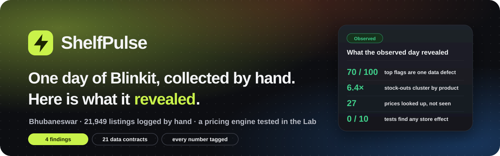</a>

# ShelfPulse · Quick-Commerce Market Intelligence

**One day of Blinkit, collected by hand: 21,949 listings in Bhubaneswar, and four things the data itself revealed.**
A data defect the anomaly detector caught on its own, stock-outs that cluster by product, prices labelled observed that
were looked up on the web, and a store column that carries no information. One day cannot show how prices move, so a
simulated 30-day market (the Lab) tests the rest of the engine: a leakage-safe feature layer, forecasting models held to
baselines, a price simulator and optimiser, and an analyst that cites a source for every claim. Everything runs in a
storefront-style web app in your browser.

[](https://deepak17kb.github.io/quickcommerce-mi/)
[](https://github.com/Deepak17kb/quickcommerce-mi/actions/workflows/ci.yml)
[](https://github.com/Deepak17kb/quickcommerce-mi/actions/workflows/pages.yml)

<!-- the next five badges are read from the last run itself (site_dist/badges/*.json, written by every site build) -->


[](LICENSE)

### [Open the live site](https://deepak17kb.github.io/quickcommerce-mi/) · [What it does](#what-you-can-do-on-the-site) · [Results](#results) · [How it works](#how-it-works) · [Run it locally](#run-it-locally)

</div>

<br>

<a href="https://deepak17kb.github.io/quickcommerce-mi/">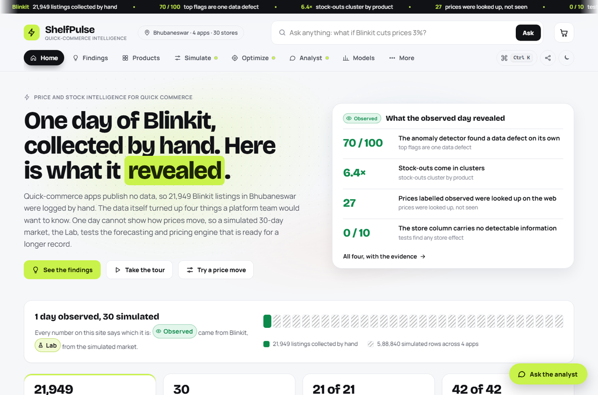</a>

## What is this?

Quick-commerce apps promise groceries in ten minutes, and the same product can cost a different amount on each of
them. This project asks three questions a seller or a shopper would ask: **who is cheapest, what is in stock, and how
fast does it arrive**. It answers them with a pipeline that runs from raw observations to a web app:

1. **Collect and validate:** 610,789 price, stock and ETA observations across 4 apps, 30 stores and 12,188 catalog
   products, frozen and hash-checked.
2. **Engineer features without leaking the future:** 109 columns, every one computed from data up to and including
   the moment it describes, never after.
3. **Model:** product matching, next price, price direction, stock-out risk, delivery time, anomalies, survival and
   restock models, competitor price response, assortment gaps.
4. **Decide:** a simulator that tests a price move before you make it, and an optimizer that finds the smallest move
   that reaches a target.
5. **Explain:** an AI analyst that answers in plain words, shows the source of every claim, and refuses questions the
   data cannot answer.
6. **Ship:** **ShelfPulse**, a storefront-style website that puts all of it one click away.

> **Method quality over headline numbers.** The project's most important rule: one day of real Blinkit data was
> observed; the 30-day, four-app panel is simulated, and every number says which it is. [Read how](#the-data-honestly).

## What you can do on the site

<table>
<tr>
<td width="50%">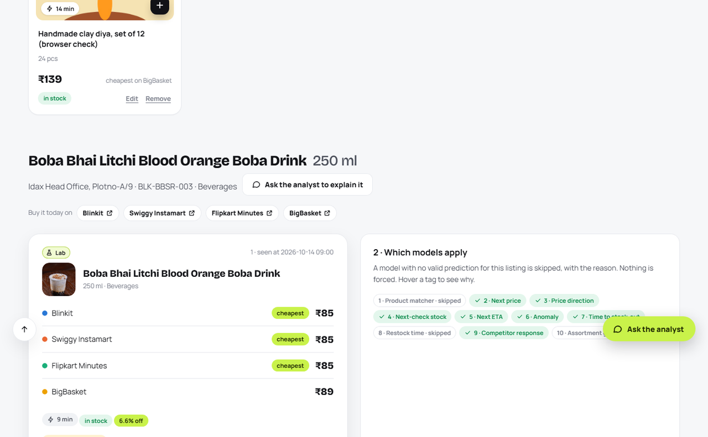<br><b>Products</b>: tap a listing and follow it through every layer: what was seen, which models apply, what they predicted next to what happened, and the move the optimizer recommends.</td>
<td width="50%">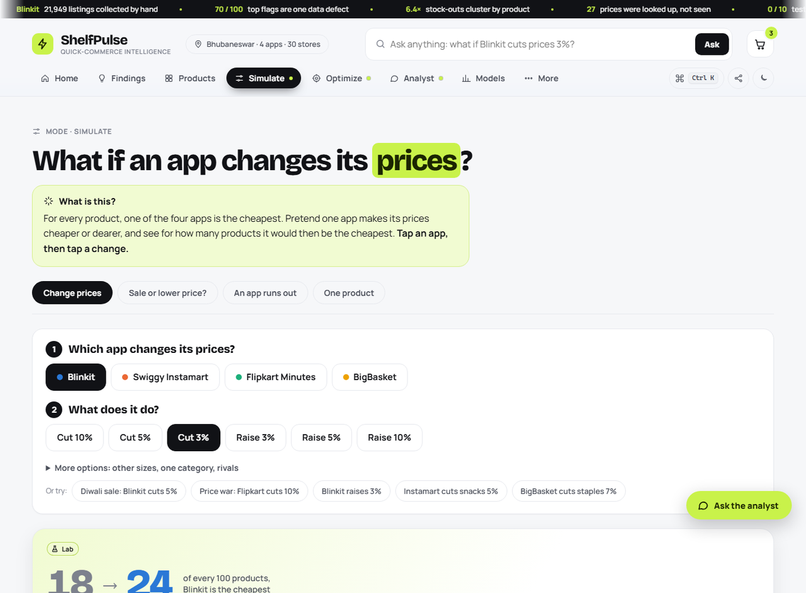<br><b>Simulate</b>: ask in a sentence ("if <i>Blinkit</i> <i>cuts</i> its prices by <i>5%</i> on <i>snacks</i>...") or tap a ready-made scenario, and read the answer in plain words: out of every 100 products, how many each app is cheapest for. Optimize works the same way: name a goal, get the smallest price cut that reaches it.</td>
</tr>
<tr>
<td>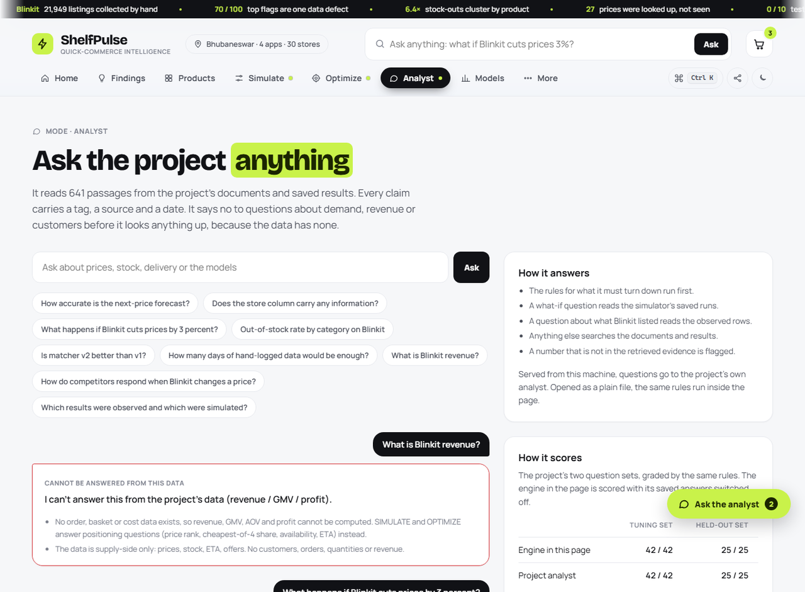<br><b>Analyst</b>: ask in plain words. Each claim carries its source and its tag; questions about sales or revenue are refused, because the data has no orders.</td>
<td>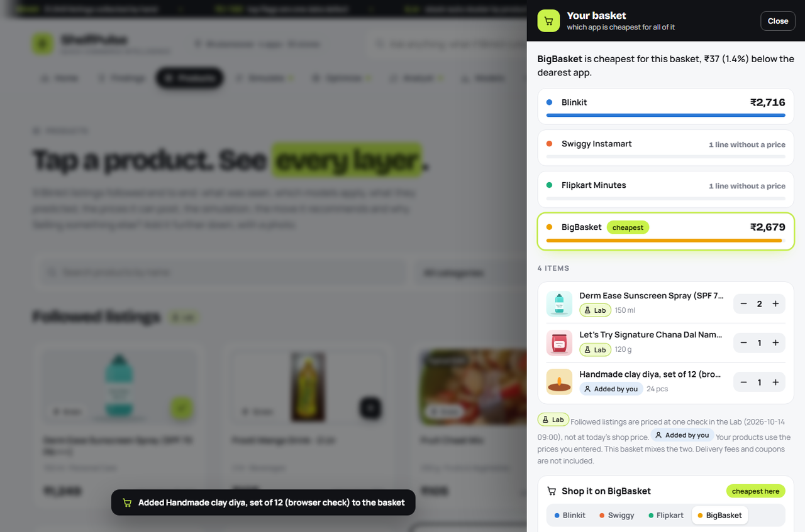<br><b>Basket</b>: add products and see which of the four apps would charge least for all of it, then shop it there: each item opens in that app's own search, one tap from its cart. Your own products (photo, prices) can join in, and export to another device.</td>
</tr>
<tr>
<td>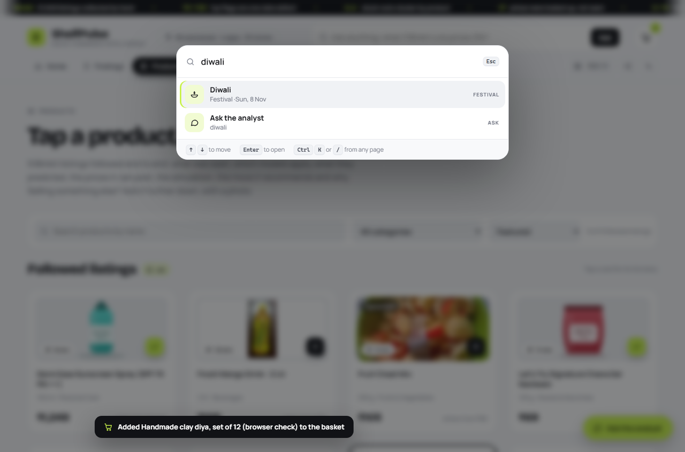<br><b>Go anywhere</b>: press <kbd>Ctrl</kbd> <kbd>K</kbd> (or <kbd>/</kbd>) to jump to any page, product or festival, or to ask a question.</td>
<td>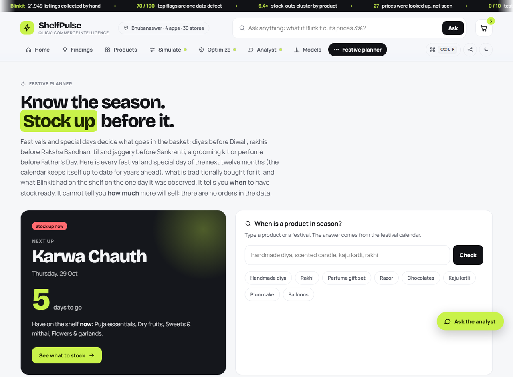<br><b>Festive planner</b>: every festival and special day of the next twelve months, Diwali to Father's Day, with a "stock up by" date and what to stock. The calendar computes itself years ahead from the sun and moon, the way a panchang does, and matches all 19 published 2026-27 dates exactly.</td>
</tr>
<tr>
<td>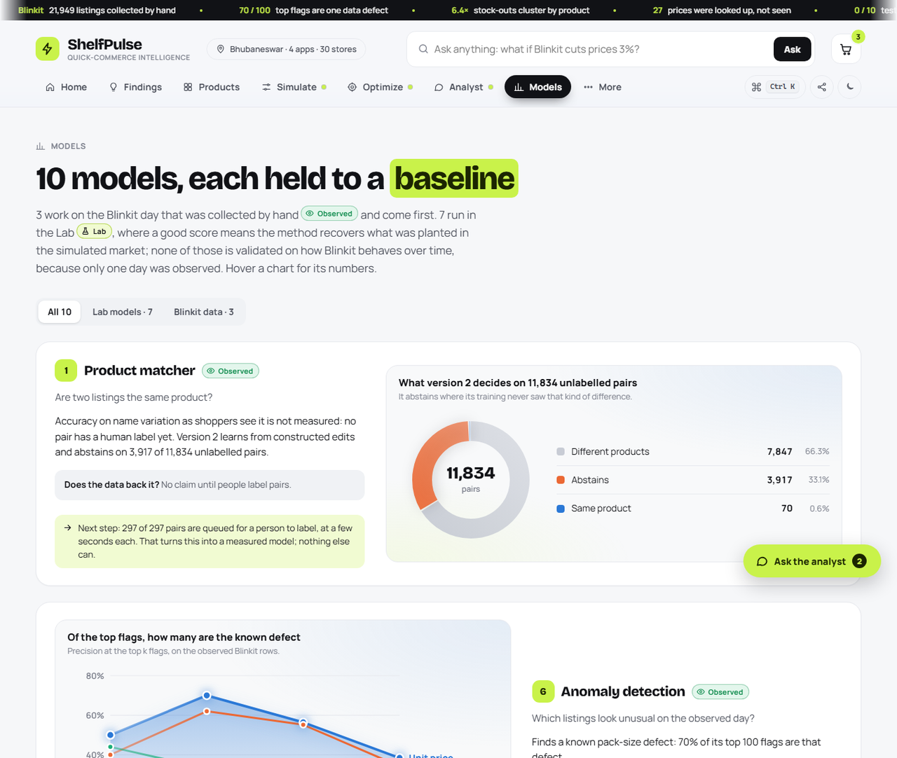<br><b>Models</b>: each model against its baselines, with a chart drawn from its own saved metrics and a line on what it may and may not claim.</td>
<td>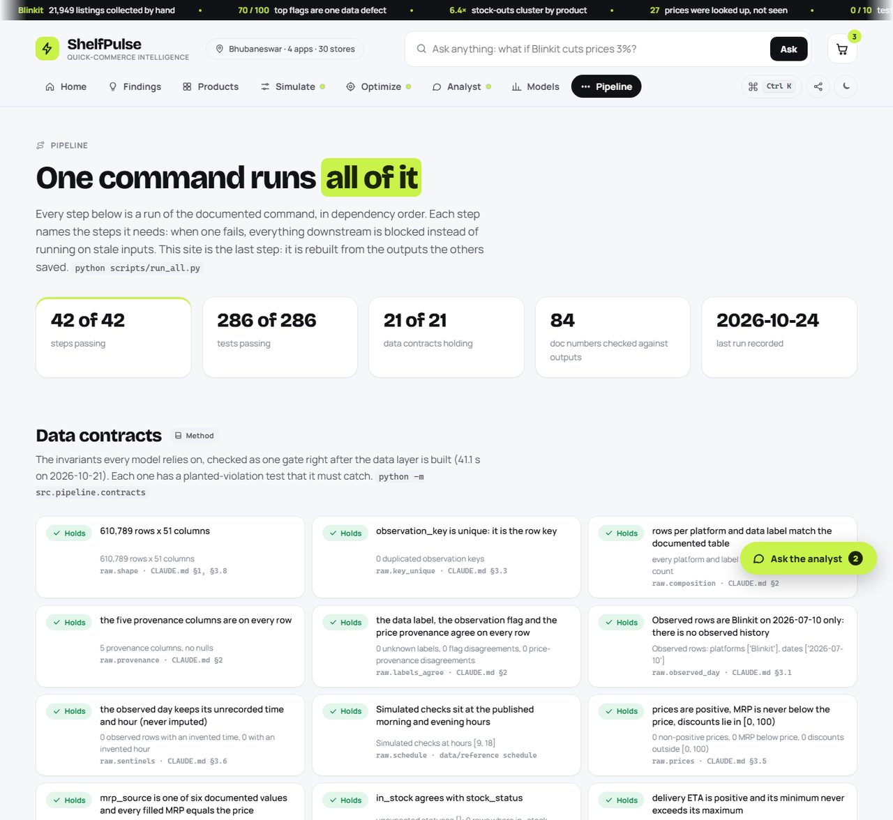<br><b>Pipeline</b>: all 42 steps with timings and logs, the 21 data contracts, and the test results, rebuilt after every run.</td>
</tr>
</table>

<details>
<summary><b>Dark mode, phones and the little things</b></summary>
<br>
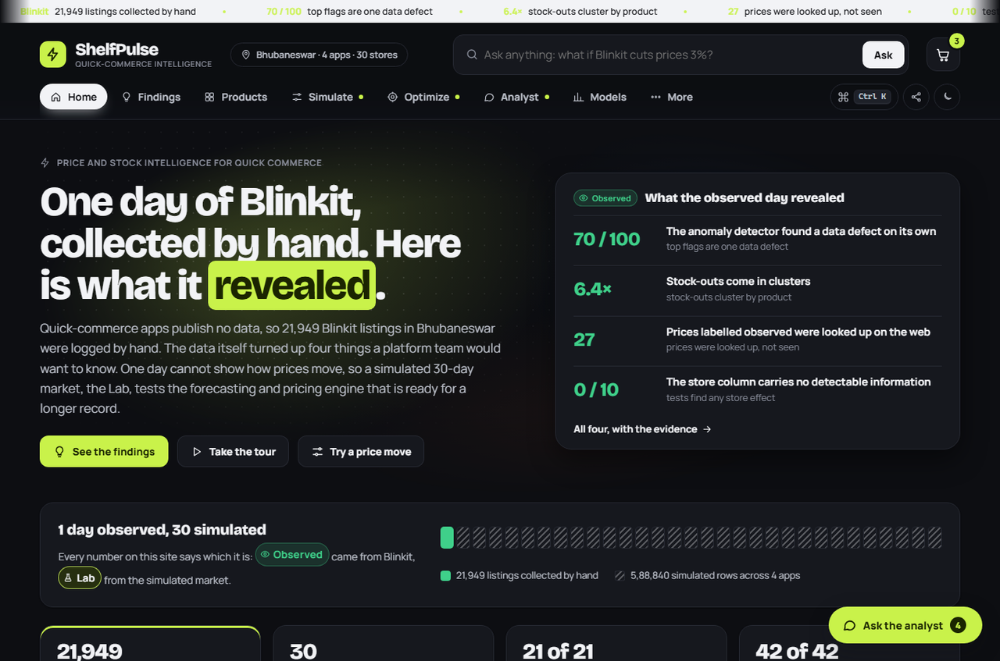
<br><br>
<p align="center">
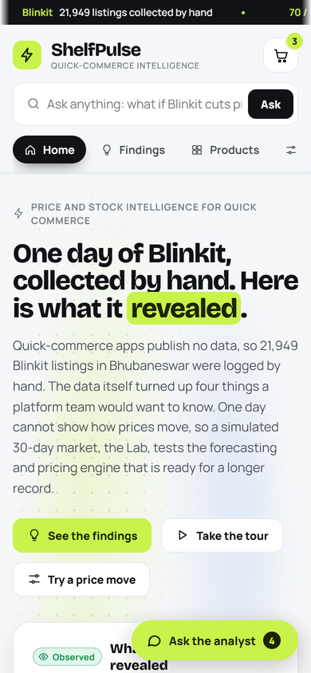
&nbsp;&nbsp;
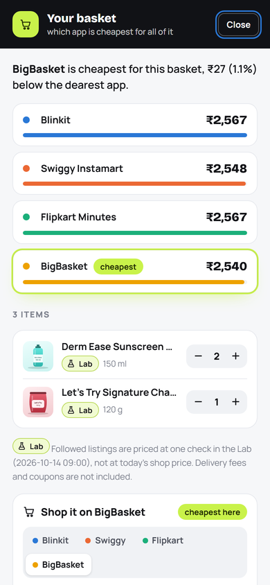
</p>

- Light and dark themes, phone, tablet and wide layouts; installable on a home screen, and it **keeps working offline**
  once loaded (a service worker, network-first so you always get the newest build).
- Hover a product and it lifts, its picture turns and the add button rises; a light follows the pointer across the
  mode cards; sections ease in as you scroll; headline numbers count up. All of it switches off for anyone whose
  system asks for reduced motion.
- Real product photos from [Open Food Facts](https://world.openfoodfacts.org) (openly licensed, CC BY-SA, credited on the Data & trust page), used only when brand and name match closely. Where none exists, a photo of the product's kind (kaju katli, marigold garlands, sweet corn) from [Wikimedia Commons](https://commons.wikimedia.org), each chosen by eye with no brand on it, free-licensed, credited, and labelled "Typical look" on the card. Everything else keeps a picture drawn from its name, pack and category. Photos from Google or the apps themselves are not used: they belong to the brands and the apps.
- New here? Home opens with three things to try, and every Simulate and Optimize page has a three-step guide and a "what do these words mean?" glossary.
</details>

## The data, honestly

Real observations cannot be collected from these apps programmatically: there are no public APIs. The Blinkit data
exists because a person collected it by hand. The other three apps, and Blinkit's history, are **simulated**, with the
owner's informed consent, and **every row says which it is**:

| Platform | Rows | What it is | Tag on the site |
|---|---:|---|---|
| Blinkit | 21,949 | observed on one day, collected by hand | none: untagged means observed |
| Blinkit | 148,740 | simulated 30-day panel | **Lab** |
| Swiggy Instamart | 150,480 | simulated 30-day panel | **Lab** |
| Flipkart Minutes | 142,320 | simulated 30-day panel | **Lab** |
| BigBasket | 147,300 | simulated 30-day panel | **Lab** |
| **Total** | **610,789** | | |

In the data, the `data_status` column carries the same tag on every row, and `src.load.real_only(df)` keeps only the
observed ones.

Product names, brands, categories, pack sizes, store names and coordinates are real throughout. On simulated rows,
prices, stock, ETA, offers and badges come from `SIMULATED_GENERATOR_v15.1`, which is calibrated to the observed day
in two places (stock-out level by category, price-ending style); `docs/GENERATOR_v15_PARAMETERS.md` marks every
parameter as calibrated or assumed. On the website simulated numbers carry the tag **Lab**; observed ones carry none.

> **Simulated structure is planted, not discovered.** When a model recovers a value the generator planted, that proves
> the modelling pipeline works, the way recovering Flipkart Minutes' planted −6% price gap proves the cross-platform
> join works. It is never a market finding, and nothing here reports one as such.

`selling_price` and `stock_status` on the 21,949 observed rows were verified against the source workbooks (last
checked 2026-09-17; neither workbook ships in this repo). 27 observed prices turned out to be web-researched rather than
seen in the app; they are listed in `data/reference/REAL_PRICE_SOURCE_AUDIT.csv` and `src.load.real_observed_price_only()`
leaves them out.

## Results

Each line says which data it rests on. **Observed** results describe Blinkit on 10 Jul 2026. **Lab** results show
the pipeline recovering what the generator planted.

| # | Deliverable | Data | Headline | Doc |
|---|---|---|---|---|
| 1 | Product matcher | Observed | real accuracy not measurable until humans label pairs | [MATCHER_v1](docs/MATCHER_v1.md) |
| 1 v2 | Product matcher v2 | Observed + constructed edits | difference-aware features generalise to edit families never trained on (98.6% on variant swaps where similarity features reach 9.6%); abstains on 33.1% of unlabelled real pairs | [MATCHER_v2](docs/MATCHER_v2.md) |
| 2 | Next-price forecast | Lab | test MAE 9.66 vs naive 10.56 (+8.5%), beating both baselines | [PRICE_FORECAST](docs/PRICE_FORECAST_v1.md) |
| 3 | Price direction | Lab | beats calibrated rules; "will drop" radar 78% precision at 5% | [PRICE_DIRECTION](docs/PRICE_DIRECTION_v1.md) |
| 4 | Stock-out classifier | Lab | two heads (depletion / restock) beat the Markov table; 6× lift at 1% alerts | [STOCKOUT_CLASSIFIER](docs/STOCKOUT_CLASSIFIER_v1.md) |
| 5 | ETA prediction | Lab | beats 3 baselines; conformal intervals cover what they promise; confounding exposed | [ETA_FORECAST](docs/ETA_FORECAST_v1.md) |
| 6 | Anomaly detection | Observed + Lab | finds a real, known pack_qty defect at 70% precision@100 | [ANOMALY](docs/ANOMALY_v1.md) |
| 7 | Stock-out survival | Lab | frailty model recovers Weibull k = 1.98 (planted 2) where pooled curves say 1.38 | [STOCKOUT_SURVIVAL](docs/STOCKOUT_SURVIVAL_v1.md) |
| 8 | Restock interval | Lab | finds the hidden fast / medium / slow groups with no labels (adjusted Rand 1.0) | [RESTOCK_INTERVAL](docs/RESTOCK_INTERVAL_v1.md) |
| 9 | Competitor price response | Lab | price grids hide half the response; indirect inference recovers 0.451 / 0.296 / 0.357 (planted 0.45 / 0.30 / 0.35) | [PRICE_RESPONSE](docs/PRICE_RESPONSE_v1.md) |
| 10 | Assortment gaps | Observed | 2.6× popularity at recovering hidden real listings; the store label it relies on is unverified | [ASSORTMENT_GAPS](docs/ASSORTMENT_GAPS_v1.md) |
| 11 | Simulate | Lab | validated on the status quo first; static what-ifs overstate a leader's gain 1.7× | [SIMULATE_OPTIMIZE](docs/SIMULATE_OPTIMIZE_v1.md) |
| 12a | Optimize: price cut | Lab | ignoring competitor response understates the needed cut by 1.62× | [SIMULATE_OPTIMIZE](docs/SIMULATE_OPTIMIZE_v1.md) |
| 12b | Optimize: restock priority | Lab | −26.7% out-of-stock exposure; "longest out first" is worse than random | [SIMULATE_OPTIMIZE](docs/SIMULATE_OPTIMIZE_v1.md) |
| 12c | Store coverage gaps | Observed | areas far from any listed store; category coverage carries the store-label caveat | [COVERAGE_12C](docs/COVERAGE_12C.md) |
| 13 | AI analyst | each claim tagged | refuses what it must; 25/25 on a held-out question set (42/42 tuning) | [AI_ANALYST](docs/AI_ANALYST_v1.md) |
| | Richer restock objective | Lab | weighting by cheapest-available wins: +6.7 pp lost-wins cut for 1.3 pp exposure | [SCENARIOS](docs/SCENARIOS_v1.md) |
| | Price increases | Lab | no free raise (1% costs 1.4-2.4 pp of cheapest share); followers soften a Blinkit raise 1.42× | [PRICE_INCREASES](docs/PRICE_INCREASES_v1.md) |
| | Product × store chain | Lab + observed context | one listing through seven stages; competitor response doubles the needed cut on 3 of 6 listings | [LISTING_CHAIN](docs/LISTING_CHAIN_v1.md) |
| | Store-label audit | Observed | ten permutation tests: the store label of the observed rows cannot be told apart from a random label | [STORE_LABEL_AUDIT](docs/STORE_LABEL_AUDIT_v1.md) |
| | Collection planner | Lab | how many days and products a hand-logged panel needs, and which results stay out of reach | [COLLECTION_PLANNER](docs/COLLECTION_PLANNER_v1.md) |
| | Market context | Public sources | cited public facts under their own tag, never mixed with observed data | [EXTERNAL_SOURCES](docs/EXTERNAL_SOURCES_v1.md) |

<details>
<summary><b>Three findings that changed the project</b></summary>

**The store label on the observed rows carries no detectable information.** Products that share a name and pack
fall in the same store in 21.0% of pairs; a label independent of the product gives 21.9%, and real per-store listing
would give close to 0. Price, stock and ETA do not vary by store either, while the same test finds the store effect
planted in the simulated rows. The source workbook records no way products were tied to stores, so the label's status
is UNVERIFIED, and that is enforced in code (`src/provenance.py`): every store-level answer carries the caveat.

**Matcher v2 learns from constructed edits, and knows where it was not taught.** Similarity features memorise each kind
of edit; features that say *what* differs carry over to kinds never seen in training. Where a pair differs in a way
training did not cover, v2 abstains rather than guess. Real-world accuracy still waits on human labels.

**A hand-logged panel can answer some questions and not others.** Cut down to what a person could log, the simulated
panel says the price gap needs more products, not more days; out-of-stock spells are biased in any panel shorter than
three weeks; and two headline results need far more than a 128-product watchlist.
</details>

**What the data cannot support.** There are no customers, orders or quantities sold, so demand forecasting, price
elasticity, reorder prediction and revenue are out of reach. Each has an honest substitute here: stock-out hazard
instead of demand, competitive price response instead of elasticity, restock intervals instead of reorders.

## How it works

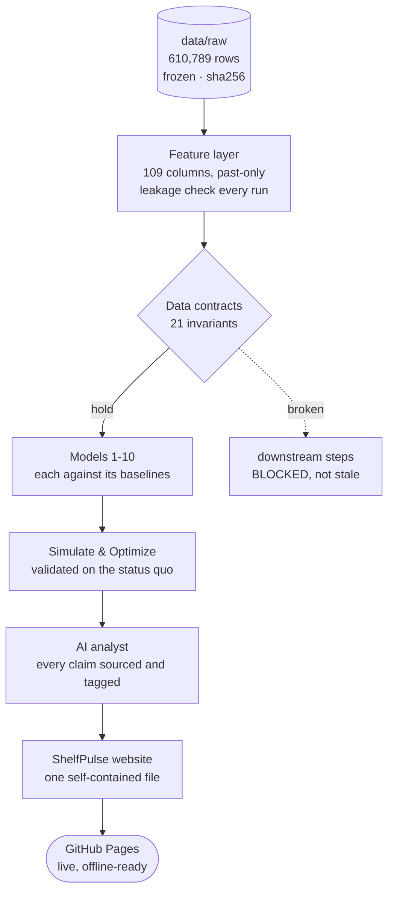

**Pipeline (`scripts/run_all.py`).** Forty-two steps, each a real run of its documented command. Every step names the
steps it needs: when one fails, everything downstream is recorded as **BLOCKED** instead of fitting on stale inputs,
while independent steps still run. `--list`, `--dry-run`, `--step`, `--from`, `--resume` and a per-step `--timeout`;
a JSON run log and a Run Log page come out of every run.

**Data contracts (`src/pipeline/contracts.py`).** Twenty-one invariants the models rely on (composition by platform
and label, provenance on every row, unrecorded fields never imputed, past-only feature bounds, a chronological split,
structural NULLs exactly where a panel starts and ends, derived tables keyed one-to-one) are checked as one gate right
after the data layer is built. Each contract has a test that plants a violation in a copy of the data and must catch it.

**Claims ledger (`scripts/check_claims.py`).** 37 headline claims in this README and the docs (84 numbers) are checked
against the saved output each came from, so a number that drifts after a rerun fails the build.

**Local server (`scripts/serve_site.py`).** Standard library only. Gzip and ETag revalidation (a reload of the
2.7 MB page costs a 304), a content security policy and no-framing headers, a Host check against DNS rebinding, a
six-digit code and per-device rate limits for phones on the same Wi-Fi, an LRU cache for the analyst's answers,
`/api/metrics` (latency percentiles, cache hits) and a JSON 500 for any unexpected error. `--public` turns it into a
read-only public service (any host, `$PORT`, per-device limits behind the host's proxy, CORS for the live site only,
about 200 MB of memory): see [the live Python analyst](#the-live-python-analyst).

**Tests.** The full suite (count in the badge above, read from the last run) covers leakage, split and identifier
guards, the planted-violation controls, server behaviour including the public mode, publishing and the fetch script's
safety checks, a node run of every page and control, and the in-browser analyst re-scored on both question sets. CI
runs on every push: one job rebuilds the feature layer from the frozen data and checks the contracts; another fetches
the released run outputs and runs **every** test. A headless-browser check visits every page in light, dark, phone,
tablet and wide layouts and fails on any script error, blocked resource or sideways scroll.

## Run it locally

```bash
git clone https://github.com/Deepak17kb/quickcommerce-mi.git
cd quickcommerce-mi
python -m venv .venv && source .venv/bin/activate        # Windows: .venv\Scripts\activate
pip install -r requirements.txt
```

**The quick way (minutes).** Every full run is published as a [release](https://github.com/Deepak17kb/quickcommerce-mi/releases):
the ML layer and every model output, as one zip. Fetch it and everything works at once:

```bash
python scripts/fetch_outputs.py          # data/ml + outputs/ from the latest release; refused if its sha256 differs
python scripts/serve_site.py             # ShelfPulse on http://localhost:8000, with the project's own Python analyst behind it
python -m pytest -q                      # every test
```

**The full way (about three hours).** Rebuild everything from the frozen raw data:

```bash
python scripts/run_all.py                # 42 steps in dependency order, then the tests and the website
```

The survival model alone takes 40 minutes; `--dry-run` shows the plan and `--resume` continues a run that stopped.
Other entry points:

```bash
python -m src.pipeline.contracts                  # the 21 data contracts
python -m src.analyst "What happens if Blinkit cuts prices by 3 percent?"
python scripts/check_claims.py                    # every headline number against the output behind it
python scripts/deploy_pages.py                    # publish the built site (commit + push; the Pages workflow deploys it)
python scripts/release_outputs.py                 # publish a finished run's outputs as a release
```

## Publishing

**The live site updates itself.** Every site build writes `site_dist/` (the page, its service worker, icons, and the
badge files above). It is tracked in git, and the Pages workflow deploys it whenever a push to `main` changes it, so a
commit and a push are the whole deploy (`python scripts/deploy_pages.py` does both).

**Run outputs are released, not committed.** The ML layer and model outputs change with every run and would bloat the
history, so each finished run is published as a GitHub Release (`scripts/release_outputs.py`, refused unless every step
and test passed), and `data/OUTPUTS_RELEASE.json` pins the one this commit was built with. Products a person adds on
their own machine (`data/user_added/`, photos from their camera) are never committed or released.

### The live Python analyst

GitHub Pages serves files only, so the live site answers with the analyst engine built into the page: the same
refusal rules, routing and sources as the Python analyst, scored on the project's own question sets (badge above). To
put the project's own Python analyst behind it, deploy the read-only server in one click, then paste its URL into
`site/config.json` and publish:

[](https://render.com/deploy?repo=https://github.com/Deepak17kb/quickcommerce-mi)

The blueprint (`render.yaml`) installs four packages, fetches the released outputs and starts
`serve_site.py --public`. A free service sleeps when idle; the page keeps answering with its own engine while it wakes
and switches to the live analyst once it does. Products you add on the live site stay in your browser: **Export** and
**Import** on the Products page move them, photos included, to another browser or device.

<details>
<summary><b>For data scientists: loading the data safely</b></summary>

```python
import src.load as L

df = L.load_ml()                                  # 610,789 x 116, targets joined
train, val, test = L.splits(df, 'future_price')   # chronological, from the split column
feats = L.feature_columns(train)                  # by schema role; identifiers and targets refused
X = L.select_features(train, feats)
observed = L.real_only(df)                        # the only rows reportable as market fact
```

Three rules hold everywhere. **Never split randomly**: the `split` column is chronological (train 15 Sep-4 Oct,
val 5-8 Oct, test 9-14 Oct). **Never feed identifiers to a model**: `feature_columns()` drops them. **Never impute the
structural NULLs**: `price_lag_1` is empty at a panel's first observation because nothing came before it.

**Leakage, found and fixed.** Five early features used `groupby().transform()` over the whole panel, so a row at time
*t* knew prices from *t+1*. They were replaced by expanding `*_to_date` versions; the convention is that a feature at
*t* may use data up to and including *t*, never later, and a data contract now enforces it.
</details>

<details>
<summary><b>Project layout</b></summary>

```
src/load.py            data access: loading, splits, column roles, feature guard
src/pipeline/          raw build history, the ML feature layer, the data contracts
src/features/          derived past-only tables: stock clock, price grid
src/matching/          product matcher v1 and v2
src/models/            deliverables 2-10, one module each
src/simulate/          the simulator and its what-ifs
src/optimize/          price cut, restock priority and their extensions
src/analyst/           the provenance-labelled AI analyst
src/chain/             one product x store through every layer
src/audit/, planner/   what the data can support; how much more data would be enough
src/seasonal/          the festive planner
site/                  the website: shell, styles, pages, in-browser analyst, service worker
scripts/               run_all, build_site, serve_site, deploy_pages, release_outputs, fetch_outputs, checks
site_dist/             the published site (written by every build; a push deploys it)
data/raw/              the frozen observation layer (parquet, hash-checked)
data/reference/        catalog, stores, schedule, audits, ML schema
docs/                  how each layer was built and what it may claim
tests/                 the full test suite
```
</details>

## License

The code is released under the [MIT License](LICENSE). The data in `data/` is shared for learning and research with
the same permission. Product, brand and store names belong to their owners and appear only to identify what was
listed. The observed Blinkit prices are one day's shelf prices (10 Jul 2026), and every simulated number is tagged
**Lab**: neither is a statement about any company's sales, revenue or pricing strategy.

## About

Built by **Deepak**, 3rd-year B.Tech CSE (Data Science with AI) at LPU, as a portfolio project.
More work: [github.com/Deepak17kb](https://github.com/Deepak17kb) · [portfolio](https://deepak17kb.github.io/)

The full engineering notes, including every settled finding and trap, are in [`CLAUDE.md`](CLAUDE.md) and [`docs/`](docs/).
